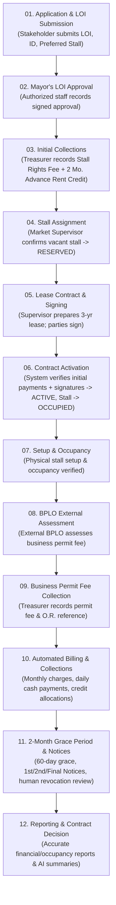

# Complete System Implementation Plan: Public Market Rental Management System of Manticao

This implementation plan refines and integrates the 5 confirmed client decisions and end-to-end 12-step workflow for the **Public Market of Manticao Rental Management System**.

---

## 1. Confirmed Client Business Rules

| Business Rule | Confirmed Implementation Logic |
| :--- | :--- |
| **1. Contract Activation** | The lease contract becomes **`ACTIVE`** only after: (1) Initial payments recorded & verified by Treasurer, (2) Stall assigned & available, and (3) Contract signed by stakeholder & LGU representative. Stall only becomes **`OCCUPIED`** once the contract is active. |
| **2. Advance Rent as Credit** | The **2-month advance rent** is **held as an available credit** (`advance_credits` / `advance_balance`). It is **NOT** automatically applied to the first two bills and is **NOT** counted as duplicate cash income. Authorized staff allocates credit to bills when requested. |
| **3. Business Permit Fee** | Collected by the **Treasurer after external BPLO assessment**. BPLO evaluation/issuance remains external. The system records assessed fee, amount paid, O.R. reference, and permit status without requiring a BPLO system login. |
| **4. Overdue Notice Schedule** | Follows the **2-month grace period** (60 days) from the bill due date. Accounts reaching 60+ days overdue become eligible for **1st Notice**, then **2nd Notice**, then **Final Demand Notice**. **Revocation is never automatic**; it requires an authorized human decision. No automatic 25% penalties. |
| **5. Mayor's LOI Approval** | Recorded by **authorized LGU staff** based on a physical signed document/LOI reference (`APPROVED` or `REJECTED`), recording the approver, decision date, and document reference. |

---

## 2. End-to-End 12-Step Target Workflow

---

## 3. Database Schema Enhancements (PostgreSQL Migration)

We will create migration `20261021_complete_system_workflow.sql` adding:
1. **`advance_credits` & `credit_allocations` tables**:
   - `advance_credits`: tracks `stakeholder_id`, `contract_id`, `payment_id`, `original_amount`, `available_amount`, `status ('AVAILABLE', 'DEPLETED', 'EXPIRED')`.
   - `credit_allocations`: tracks `advance_credit_id`, `billing_id`, `allocated_amount`, `allocated_by`, `allocated_at`.
2. **`contracts` table enhancements**:
   - `initial_payments_verified` (BOOLEAN)
   - `signed_by_stakeholder` (BOOLEAN)
   - `signed_by_lgu` (BOOLEAN)
   - `signed_at` (TIMESTAMPTZ)
   - `status`: supports `'DRAFT', 'PENDING_PAYMENT', 'PENDING_SIGNATURE', 'ACTIVE', 'EXPIRED', 'REVOKED', 'TERMINATED'`.
3. **`notices` table**:
   - `id`, `notice_no`, `contract_id`, `stakeholder_id`, `notice_type ('FIRST_NOTICE', 'SECOND_NOTICE', 'FINAL_DEMAND')`, `balance_snapshot`, `issued_at`, `issued_by`, `delivery_status`, `notes`.
4. **Relaxed RLS policies**:
   - Allows authenticated municipal staff and app workflows to insert/update `stalls`, `contracts`, `billings`, and `payments` without `42501` errors.

---

## 4. Implementation Steps & Action Items

### Step 1: Database Migration (`supabase/migrations/20261021_complete_system_workflow.sql`)
- Create tables: `advance_credits`, `credit_allocations`, `notices`.
- Add contract verification columns (`initial_payments_verified`, `signed_by_stakeholder`, `signed_by_lgu`).
- Set up idempotent RLS policies preventing 42501 errors.

### Step 2: Backend Routing & API Adapter (`src/services/api.js`)
- Add endpoints for:
  - `POST /advance-credits/allocate`: allocate credit to billing.
  - `POST /contracts/:id/sign`: record stakeholder & LGU signatures.
  - `POST /contracts/:id/activate`: explicit gate checking payments & signatures before setting `ACTIVE` and stall `OCCUPIED`.
  - `POST /notices`: generate and issue 1st, 2nd, or Final Demand notice.
  - `POST /payments`: record daily/partial collections and update billing balance atomically.
  - `PUT /applications/:id/mayor-decision`: record Mayor's LOI decision with signed document reference.

### Step 3: Service Layer Updates
- `src/services/contractService.js`: logic for contract preparation, signing, and activation gate.
- `src/services/billingService.js`: daily collection recording, 2-month grace period logic, and advance credit deduction.
- `src/services/paymentService.js`: support initial fees vs regular collections vs business permit fee.

### Step 4: UI Updates Across Roles
- **Treasurer**: Initial payments (separate rights fee & advance credit), Daily Collections, Advance Credit Allocation, Business Permit Fee recording.
- **Market Supervisor**: Mayor LOI approval recording, Stall assignment, Lease contract preparation & signing, Contract activation gate, Grace period & notice tracking.
- **Stakeholder**: Updated progress timeline reflecting the 12-step flow, advance credit view, daily payment history.
